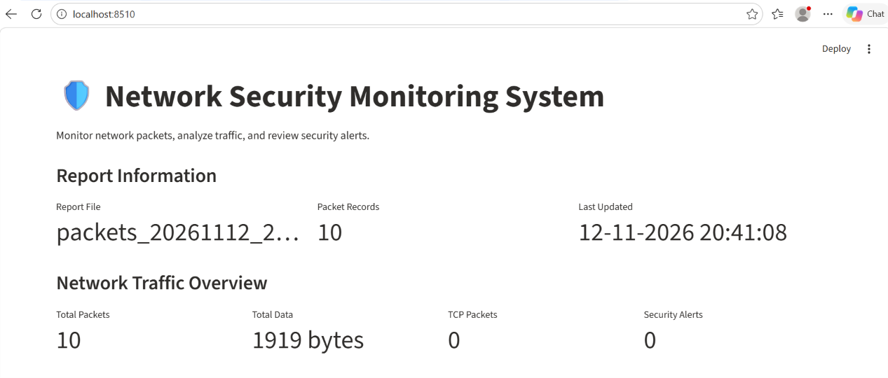
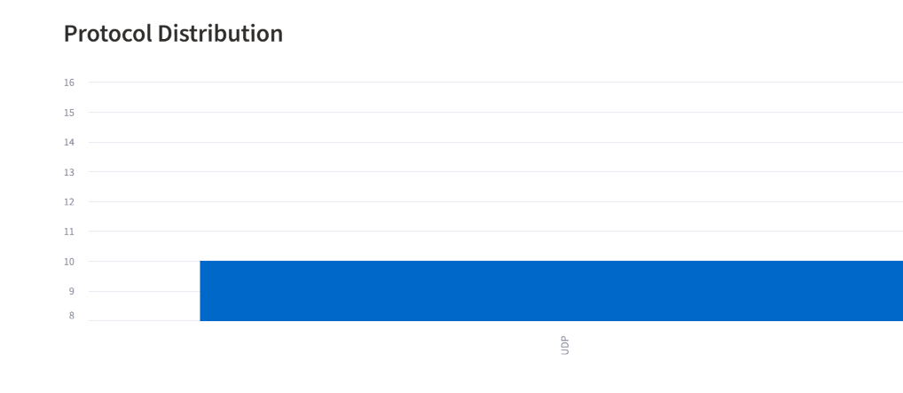
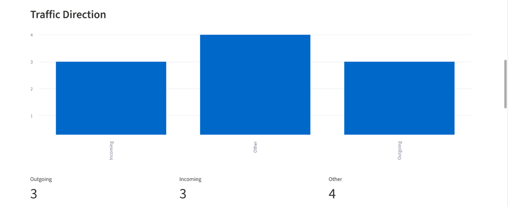
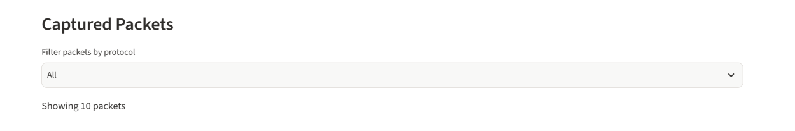
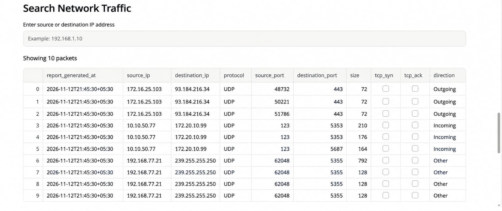
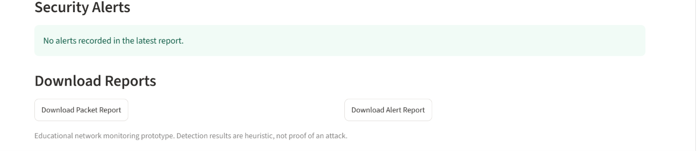
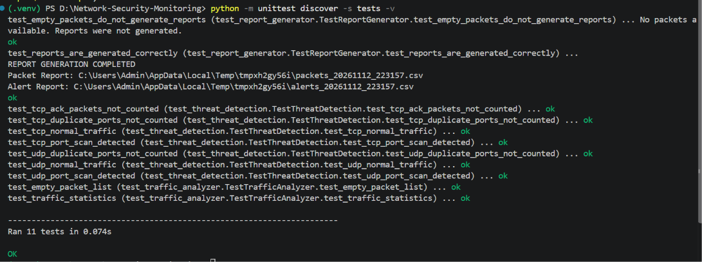

# Network Security Monitoring System

A Python-based Network Security Monitoring System (NSMS) that captures IPv4 network packets, analyzes network traffic, detects potential TCP and UDP port-scanning activity, and generates CSV security reports through an interactive Streamlit dashboard.

## Project Overview

This project demonstrates the fundamentals of network security monitoring using Python.

It captures network traffic from a selected network interface and analyzes packet information to identify suspicious traffic patterns.

The system provides a dashboard for reviewing captured packets, traffic statistics, and security alerts.

## Features

- IPv4 packet capture using Scapy.
- Network traffic analysis.
- TCP SYN-based port scan detection.
- UDP port scan detection using unique destination ports.
- Source and destination IP analysis.
- Incoming, outgoing, and other traffic classification.
- CSV packet and security alert reports.
- Interactive Streamlit dashboard.
- Protocol filtering.
- IP address searching.
- Automatic dashboard refresh.
- CSV report downloads.
- Automated unit testing.

## Technologies Used

| Technology | Purpose |
|---|---|
| Python | Core programming language |
| Scapy | Network packet capture |
| Streamlit | Interactive dashboard |
| Pandas | CSV data handling |
| Wireshark | Network traffic inspection |
| Npcap | Windows packet capture support |
| Unittest | Automated testing |
| Git | Version control |
| GitHub | Project hosting |

## Project Structure

```text
Network-Security-Monitoring/
│
├── data/
│   ├── raw/
│   └── processed/
│
├── src/
│   ├── packet_capture.py
│   ├── traffic_analyzer.py
│   ├── threat_detection.py
│   └── report_generator.py
│
├── dashboard/
│   └── app.py
│
├── reports/
│
├── tests/
│   ├── test_threat_detection.py
│   ├── test_report_generator.py
│   └── test_traffic_analyzer.py
│
├── docs/
│
├── requirements.txt
├── README.md
└── .gitignore
```

## Installation

### Prerequisites

- Windows operating system
- Python
- Git
- Wireshark and Npcap
- VS Code (recommended)

### Step 1: Clone the repository

```bash
git clone YOUR_GITHUB_REPOSITORY_URL
cd Network-Security-Monitoring
```

### Step 2: Create a virtual environment

```powershell
py -m venv .venv
```

### Step 3: Activate the virtual environment

```powershell
.\.venv\Scripts\Activate.ps1
```

### Step 4: Install dependencies

```powershell
pip install -r requirements.txt
```

## Running the Project

### Step 1: Capture network packets

Open PowerShell as Administrator if required for packet capture.

```powershell
python .\src\packet_capture.py
```

Select your network interface from the displayed list.

The program captures 10 IPv4 packets and processes them.

### Step 2: View the dashboard

In another terminal with the virtual environment activated:

```powershell
streamlit run .\dashboard\app.py
```

Open the local Streamlit address displayed in the terminal.

### Step 3: View generated reports

Packet and alert reports are saved in the `reports/` directory.

The dashboard also provides CSV download options.

## Threat Detection

### TCP Port Scan Detection

Identifies a possible TCP port scan when a source IP sends TCP SYN packets without ACK to at least 10 distinct destination ports on the same destination IP.

### UDP Port Scan Detection

Identifies a possible UDP port scan when a source IP sends UDP packets to at least 10 distinct destination ports on the same destination IP.

Both detection methods use simple threshold-based heuristics.

## Automated Testing

Run the test suite:

```powershell
python -m unittest discover -s tests -v
```

### Verified Test Results

The project has passed 11 automated tests:

- 7 threat detection tests.
- 2 report generation tests.
- 2 traffic analysis tests.

These tests use synthetic packet data and temporary report directories where appropriate.

## Dashboard

The dashboard provides:

- Network traffic overview.
- Protocol distribution.
- Traffic direction statistics.
- Captured packet table.
- Protocol filtering.
- IP address searching.
- Security alert information.
- CSV report downloads.

## Project Screenshots

### 1. Network Security Monitoring Dashboard



### 2. Protocol Distribution



### 3. Traffic Direction



### 4. Captured Network Packets



### 5. Network Traffic Search



### 6. Security Alerts and Report Downloads



### 7. Automated Testing

All 11 automated tests passed.




## Limitations

- This is an educational network monitoring prototype, not a production-grade IDS.
- Packet capture currently processes IPv4 packets only.
- Detection is based on simple threshold heuristics.
- TCP and UDP scan detection can produce false positives or miss some scanning techniques.
- The current capture operation processes a fixed number of packets rather than continuously monitoring traffic.
- Detection results are indicators, not proof of an attack.

## Ethical Use

Use this project only on your own devices and networks or on networks for which you have explicit authorization.

Do not use it to intercept other people's traffic or access private information.

## Future Improvements

- Continuous packet monitoring.
- Advanced threat detection.
- Configurable detection thresholds.
- IPv6 support.
- Improved dashboard visualizations.
- Database integration.
- Alert notifications.
- More comprehensive automated tests.

## Author

Developed as a hands-on cybersecurity and Python learning project.

## License

This project can be published under the MIT License after adding a corresponding LICENSE file.
